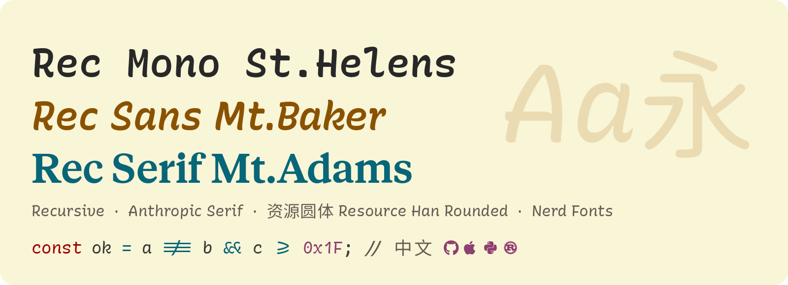
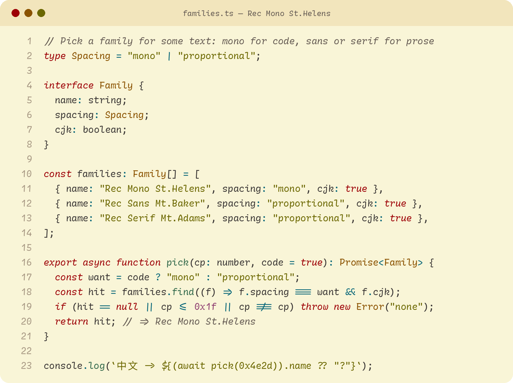
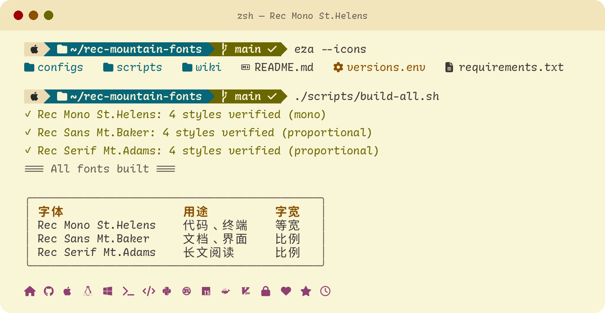
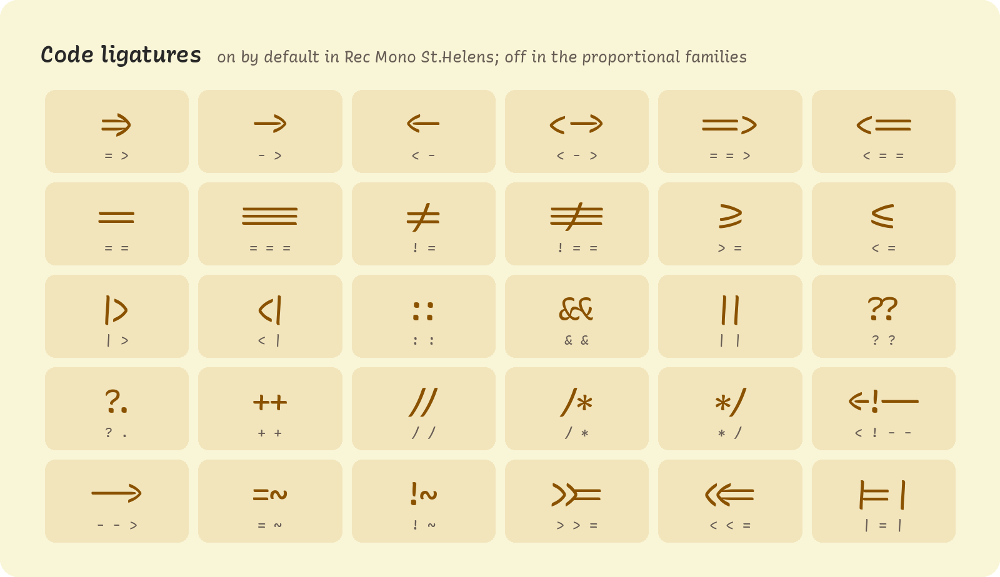
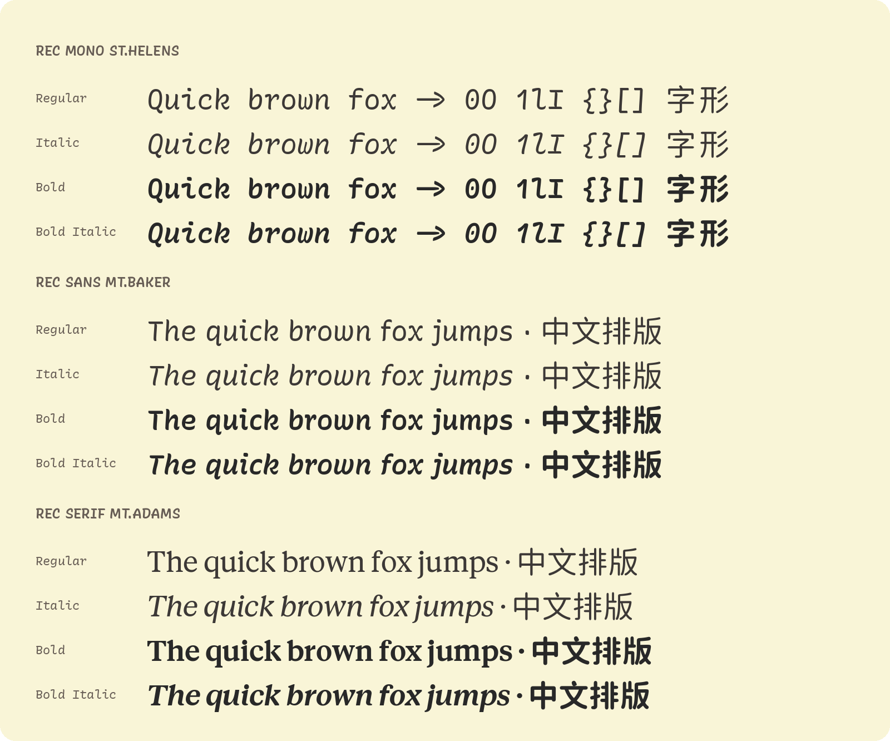
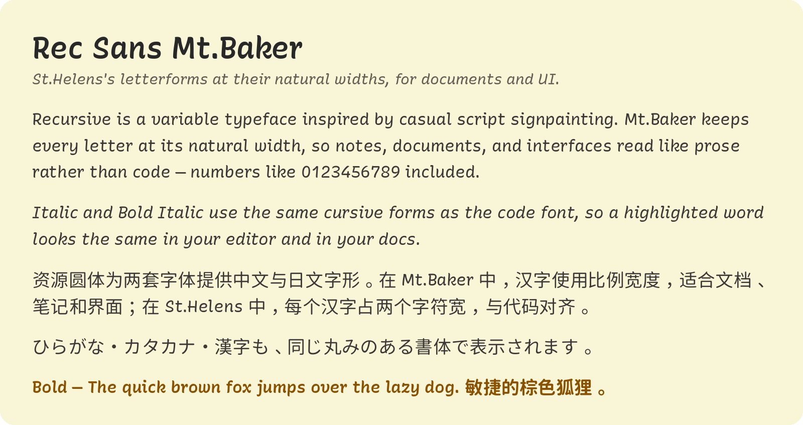
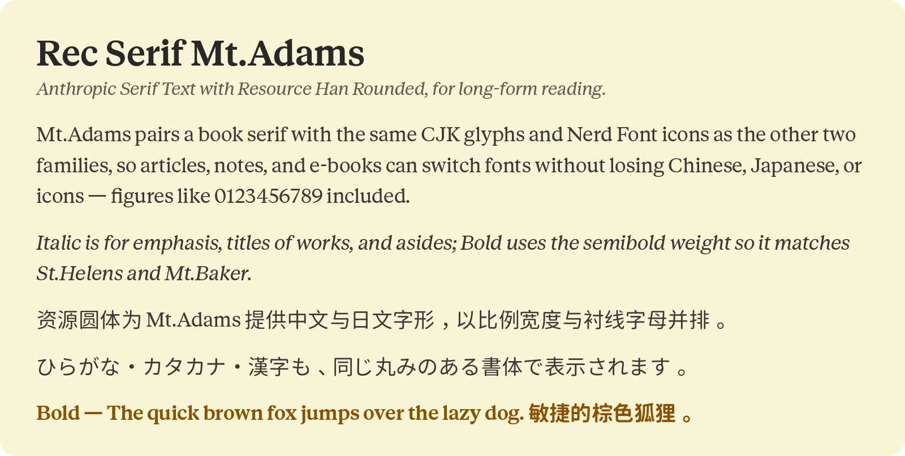
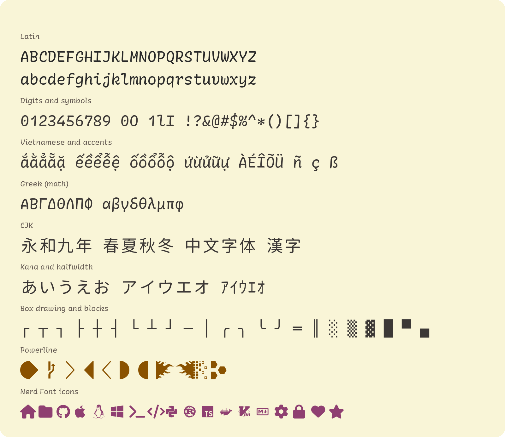

# Rec Mountain Fonts

[](https://github.com/D0n9X1n/rec-mountain-fonts/actions/workflows/ci.yml)
[](https://github.com/D0n9X1n/rec-mountain-fonts/actions/workflows/release.yml)
[](https://github.com/D0n9X1n/rec-mountain-fonts/actions/workflows/publish-wiki.yml)
[](https://github.com/D0n9X1n/rec-mountain-fonts/releases/latest)
[](https://github.com/D0n9X1n/rec-mountain-fonts/releases/latest)
[](https://github.com/D0n9X1n/rec-mountain-fonts/releases)
[](https://github.com/D0n9X1n/rec-mountain-fonts/stargazers)
[](https://github.com/D0n9X1n/rec-mountain-fonts/issues)
[](https://github.com/D0n9X1n/rec-mountain-fonts/pulls)
[](https://github.com/D0n9X1n/rec-mountain-fonts/commits/main)

[](https://github.com/arrowtype/recursive/releases/tag/v1.085)
[](https://bspk.xyz)
[](https://github.com/CyanoHao/Resource-Han-Rounded/releases/tag/v0.990)
[](https://github.com/ryanoasis/nerd-fonts/releases/tag/v3.5.1)
[](https://github.com/D0n9X1n/rec-mountain-fonts/wiki)
[](#license)
[](LICENSE)

<picture>
  <source media="(prefers-color-scheme: dark)" srcset="docs/previews/hero-dark.png">
  
</picture>

Three font families with CJK glyphs from [Resource Han Rounded (资源圆体)](https://github.com/CyanoHao/Resource-Han-Rounded) and the full [Nerd Fonts](https://www.nerdfonts.com/) icon set.

| Family | Latin design | Use | Spacing |
|---|---|---|---|
| **Rec Mono St.Helens** | [Recursive](https://recursive.design), casual cursive | Coding and terminals | Monospace, code ligatures |
| **Rec Sans Mt.Baker** | [Recursive](https://recursive.design), casual cursive | Everyday text and UI | Proportional |
| **Rec Serif Mt.Adams** | Anthropic Serif Text | Long-form reading | Proportional |

St.Helens and Mt.Baker share one design. Every family has four styles: Regular, Italic, Bold, and Bold Italic.

## Preview

### Code

<picture>
  <source media="(prefers-color-scheme: dark)" srcset="docs/previews/code-dark.png">
  
</picture>

### Terminal

<picture>
  <source media="(prefers-color-scheme: dark)" srcset="docs/previews/terminal-dark.png">
  
</picture>

### Ligatures

<picture>
  <source media="(prefers-color-scheme: dark)" srcset="docs/previews/ligatures-dark.png">
  
</picture>

### Styles

<picture>
  <source media="(prefers-color-scheme: dark)" srcset="docs/previews/styles-dark.png">
  
</picture>

### Text

<picture>
  <source media="(prefers-color-scheme: dark)" srcset="docs/previews/text-dark.png">
  
</picture>

### Serif

<picture>
  <source media="(prefers-color-scheme: dark)" srcset="docs/previews/serif-dark.png">
  
</picture>

### Glyph coverage

<picture>
  <source media="(prefers-color-scheme: dark)" srcset="docs/previews/glyphs-dark.png">
  
</picture>

Images are rendered from the release fonts by `scripts/render-previews.py`.

## Install

Download the fonts from the [latest release](https://github.com/D0n9X1n/rec-mountain-fonts/releases/latest) and install them. Per-OS steps are on the [Installation](https://github.com/D0n9X1n/rec-mountain-fonts/wiki/Installation) page.

## Build

```bash
brew install fontforge sevenzip
python3 -m venv venv && source venv/bin/activate
pip install -r requirements.txt
./scripts/build-all.sh          # → fonts/<Family>/*.ttf
```

The build downloads the upstream releases pinned in `versions.env`. See [Building](https://github.com/D0n9X1n/rec-mountain-fonts/wiki/Building).

## Documentation

The [wiki](https://github.com/D0n9X1n/rec-mountain-fonts/wiki) ([简体中文](https://github.com/D0n9X1n/rec-mountain-fonts/wiki/Home-zh-CN)) covers the fonts, configuration, the build pipeline, and the release process. Its source is the `wiki/` directory in this repository.

## Credits

[Recursive](https://github.com/arrowtype/recursive) by Arrow Type · Anthropic Serif by [BSPK](https://bspk.xyz) for Anthropic · [Resource Han Rounded](https://github.com/CyanoHao/Resource-Han-Rounded) by CyanoHao · [Nerd Fonts](https://github.com/ryanoasis/nerd-fonts) by Ryan L McIntyre · based on [recursive-code-config](https://github.com/arrowtype/recursive-code-config) by Arrow Type

## License

The build scripts are [MIT](LICENSE). Rec Mono St.Helens and Rec Sans Mt.Baker are derived from Recursive and Resource Han Rounded, both under the [SIL Open Font License 1.1](https://openfontlicense.org). Rec Serif Mt.Adams's Latin glyphs come from Anthropic Serif (© 2025 Anthropic PBC), which is not under the OFL; its CJK glyphs come from Resource Han Rounded. All three families include Nerd Fonts glyphs under their [respective licenses](https://github.com/ryanoasis/nerd-fonts/blob/master/LICENSE).
