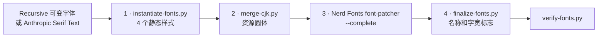

# 构建流程

[English](Build-Pipeline)

`scripts/build.sh` 分四个阶段构建一套字体，然后校验结果。第 2、3 阶段并行处理四种样式；
每个任务把日志写到 `build/<字体>/logs/` 下各自的文件中，任何失败都会停止构建并显示日志末尾。

## 阶段 1：实例化

`scripts/instantiate-fonts.py` 按配置的 `Base` 生成每种样式。`recursive` 从可变字体生成：

- 固定 `MONO`、`CASL`、`wght`、`slnt` 和 `CRSV` 轴，并移除重叠轮廓
- 删除 `STAT` 表，让 Windows 把四种样式识别为同一字体家族
- 用 `pyftfeatfreeze` 固化 `rvrn` 和配置的风格集
- 对开启连字的等宽字体运行 `dlig2calt.py`
- 设置等宽标志、PANOSE 比例、样式位和名称
- 用 ttfautohint 添加微调指令

`anthropic-serif` 从配置的静态字重生成：

- 把字体从每 em 2000 单位缩放到 1000 单位
- 把 CFF 轮廓转换为二次 TrueType 轮廓
- 删除 `STAT`，并设置名称、PANOSE 比例和样式位
- 用 ttfautohint 添加微调指令

## 阶段 2：合入中日文

`scripts/merge-cjk.py` 在 FontForge 中运行。它从资源圆体复制汉字、假名以及全角/半角区段，
按拉丁字体的行高乘以中日文缩放比例（默认 1.1）缩放并居中。等宽字体使用精确的单元格宽度；
比例字体保留每个字形自身缩放后的宽度（`--proportional`）。

## 阶段 3：Nerd Fonts

上游 `font-patcher` 加入全部图标集（`--complete`）。比例字体额外使用
`--variable-width-glyphs`，让图标保持自然宽度。

## 阶段 4：收尾

补丁工具会在所有名称后加上 "Nerd Font"，并在带两格图标的等宽字体上清除等宽标志。
`scripts/finalize-fonts.py` 按配置重写名称，并为等宽字体恢复：

| 字段 | 值 | 原因 |
|---|---|---|
| `post.isFixedPitch` | 1 | Windows Terminal 和 DirectWrite 直接读取此标志。为 0 时它们逐字形排版并使用亚像素步进，舍入误差会让 ASCII 偏离单元格网格。 |
| `OS/2.xAvgCharWidth` | 600 | 部分 Windows 排版代码把它当作单元格宽度。 |
| `head.flags` 第 4 位 | 清除 | 置位时 DirectWrite 允许微调指令在渲染时改变步进宽度。 |

## 校验

`scripts/verify-fonts.py` 检查每个构建出的字体，任何错误都会让构建失败：

| 检查 | 等宽 | 比例 |
|---|---|---|
| 字体名和样式名与配置一致，且不再含 "Nerd" | 是 | 是 |
| 包含 中、あ、一个 Nerd Font 图标和一个 Powerline 箭头 | 是 | 是 |
| `post.isFixedPitch` | 1 | 0 |
| ASCII 步进宽度 | 全部等于空格 | 至少两种不同宽度 |
| 汉字步进宽度 | 两格 | — |
| `head.flags` 第 4 位 | 清除 | — |
