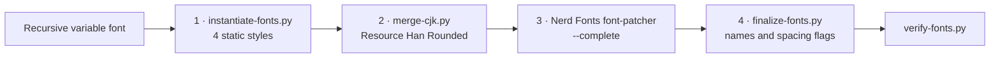

# Build Pipeline

[简体中文](Build-Pipeline-zh-CN)

`scripts/build.sh` builds one family in four stages, then verifies the result.
Stages 2 and 3 run the four styles in parallel; each job writes its own log under
`build/<family>/logs/`, and any failure stops the build with the log's tail.

## Stage 1: instantiate

`scripts/instantiate-fonts.py` makes each style from the variable font:

- pins the `MONO`, `CASL`, `wght`, `slnt`, and `CRSV` axes and removes overlaps
- drops the `STAT` table so Windows links the four styles as one family
- freezes `rvrn` and the configured stylistic sets with `pyftfeatfreeze`
- for mono families with ligatures, runs `dlig2calt.py`
- sets the fixed-pitch flags, PANOSE proportion, style bits, and names
- hints the font with ttfautohint

## Stage 2: merge CJK

`scripts/merge-cjk.py` runs under FontForge. It copies the CJK, kana, and
full-width/halfwidth ranges from Resource Han Rounded, scales them to fit
Recursive's line height times the CJK scale (default 1.15), and centres them.
Mono families get exact cell widths; proportional families keep each glyph's
own scaled width (`--proportional`).

## Stage 3: Nerd Fonts

The upstream `font-patcher` adds every icon set (`--complete`). Proportional
families also get `--variable-width-glyphs`, so icons keep their natural width.

## Stage 4: finalize

The patcher appends "Nerd Font" to every name, and on a mono family with
two-cell icons it clears the fixed-pitch flag. `scripts/finalize-fonts.py`
rewrites the names from the config and, for mono families, restores:

| Field | Value | Why |
|---|---|---|
| `post.isFixedPitch` | 1 | Windows Terminal and DirectWrite read this flag directly. When it is 0 they lay text out glyph by glyph with subpixel advances, and rounding moves ASCII off the cell grid. |
| `OS/2.xAvgCharWidth` | 600 | Some Windows layout code uses it as the cell width. |
| `head.flags` bit 4 | cleared | When set, DirectWrite lets hinting adjust advance widths at render time. |

## Verification

`scripts/verify-fonts.py` checks every built font and fails the build on any
error:

| Check | Mono | Proportional |
|---|---|---|
| Family and style names match the config, with no "Nerd" left | Yes | Yes |
| 中, あ, a Nerd Font icon, and a Powerline arrow are present | Yes | Yes |
| `post.isFixedPitch` | 1 | 0 |
| ASCII advances | All equal to the space | At least two different widths |
| CJK advance | Two cells | — |
| `head.flags` bit 4 | Clear | — |
