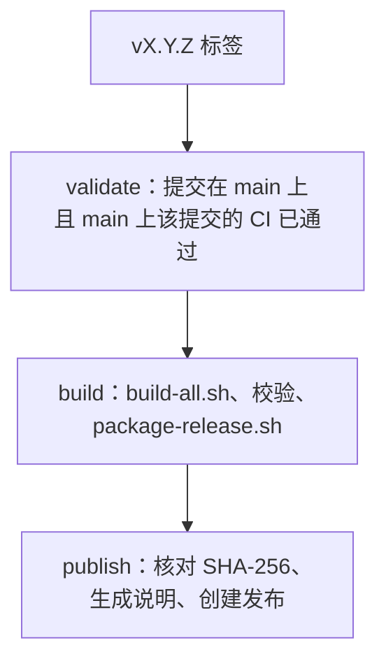

# 发布流程

[English](Release-Process)

发布从推送标签开始，标签所在的提交必须已经在 `main` 上通过 CI。

## 持续集成

`.github/workflows/ci.yml` 在每个拉取请求和每次推送到 `main` 时运行：

| 任务 | 内容 |
|---|---|
| 脚本、配置和百科 | `./scripts/local-gate.sh` |
| 构建并校验字体 | `./scripts/build-all.sh`，然后把字体上传为保留 14 天的构件 |

上游源文件按 `versions.env` 的哈希缓存。每个 action 都固定到提交 SHA，工作流令牌为只读。
Dependabot 每月提出 action 更新，每周提出 Python 补丁版本更新。

## 发布工作流

推送匹配 `v<主>.<次>.<补丁>` 的标签会启动 `.github/workflows/release.yml`。含 `-` 的标签
（例如 `v2.1.0-rc.1`）作为预发布版本发布。



只有 publish 任务能写入仓库。标签打在未合并的提交上，或该提交在 `main` 上的 CI 失败或
尚未完成时，流程会在 validate 阶段停止。

## 发布资产

| 资产 | 内容 |
|---|---|
| `RecMonoSt.Helens-*.ttf` | St.Helens 四种样式 |
| `RecSansMt.Baker-*.ttf` | Mt.Baker 四种样式 |
| `rec-mountain-fonts-<tag>.zip` | 全部八个字体 |
| `SHA256SUMS.txt` | 每个字体和压缩包的 SHA-256 |

`scripts/release-notes.sh` 生成发布说明：字体列表、`versions.env` 中的上游版本、
自上一个标签以来的提交标题，以及校验和。

## 发布新版本

1. 合并拉取请求，等待 `main` 上的 CI 通过。
2. 给合并提交打标签并推送：

   ```bash
   git switch main && git pull
   git tag v2.1.0
   git push origin v2.1.0
   ```

3. 观察 Release 工作流，然后检查发布页上的资产。

如果因为 `main` 上的 CI 尚未完成而校验失败，删除标签
（`git push origin :refs/tags/v2.1.0`、`git tag -d v2.1.0`），等 CI 通过后再推送。

## 版本号

| 升级 | 场景 |
|---|---|
| 主版本 | 字体改名或移除，或其字宽、设计默认值改变 |
| 次版本 | 上游版本或风格集改变，或新增字体、字形覆盖 |
| 补丁版本 | 不改变字形的元数据、命名或构建修复 |
