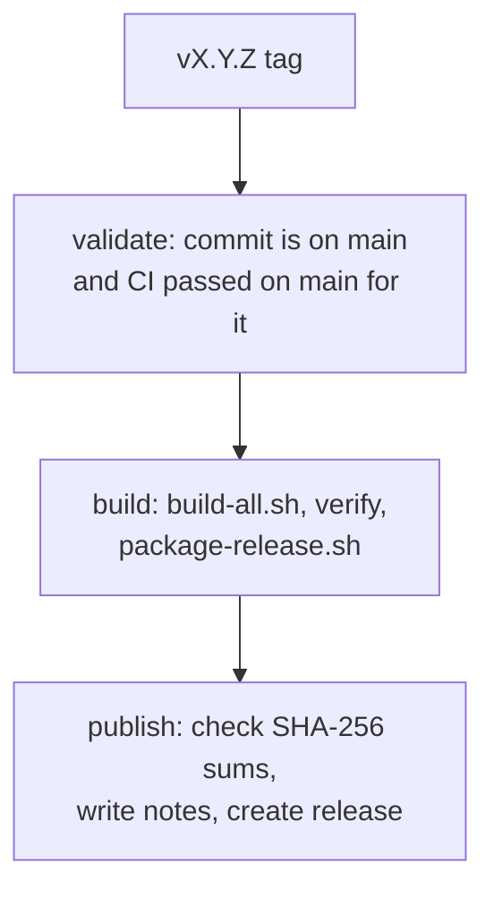

# Release Process

[简体中文](Release-Process-zh-CN)

A release starts from a pushed tag on a commit that already passed CI on `main`.

## Continuous integration

`.github/workflows/ci.yml` runs on every pull request and every push to `main`:

| Job | What it runs |
|---|---|
| Scripts, configs, and wiki | `./scripts/local-gate.sh` |
| Build and verify fonts | `./scripts/build-all.sh`, then uploads the fonts as a 14-day artifact |

Upstream sources are cached by the hash of `versions.env`. Every action is
pinned to a commit SHA, and the workflow token is read-only. Dependabot proposes
action updates monthly and patch-level Python updates weekly.

## Release workflow

Pushing a tag that matches `v<major>.<minor>.<patch>` starts
`.github/workflows/release.yml`. A tag containing `-`, such as `v2.1.0-rc.1`, is
published as a pre-release.



Only the publish job can write to the repository. A tag on an unmerged commit,
or on a commit whose `main` CI run failed or has not finished, stops at
validation.

## Published assets

| Asset | Contents |
|---|---|
| `RecMonoSt.Helens-*.ttf` | Four St.Helens styles |
| `RecSansMt.Baker-*.ttf` | Four Mt.Baker styles |
| `m-fonts-<tag>.zip` | All eight fonts |
| `SHA256SUMS.txt` | SHA-256 of every font and the zip |

`scripts/release-notes.sh` writes the notes: the families, the upstream
versions from `versions.env`, the commit subjects since the previous tag, and
the checksums.

## Cutting a release

1. Merge the pull request and wait for CI on `main` to pass.
2. Tag the merge commit and push the tag:

   ```bash
   git switch main && git pull
   git tag v2.1.0
   git push origin v2.1.0
   ```

3. Watch the Release workflow, then check the release page's assets.

If validation fails because `main` CI had not finished, delete the tag
(`git push origin :refs/tags/v2.1.0`, `git tag -d v2.1.0`) and push it again
after CI passes.

## Version numbers

| Bump | When |
|---|---|
| Major | A family is renamed or removed, or its spacing or design defaults change |
| Minor | An upstream version changes, or a family or glyph coverage is added |
| Patch | Metadata, naming, or build fixes that leave the glyphs unchanged |
